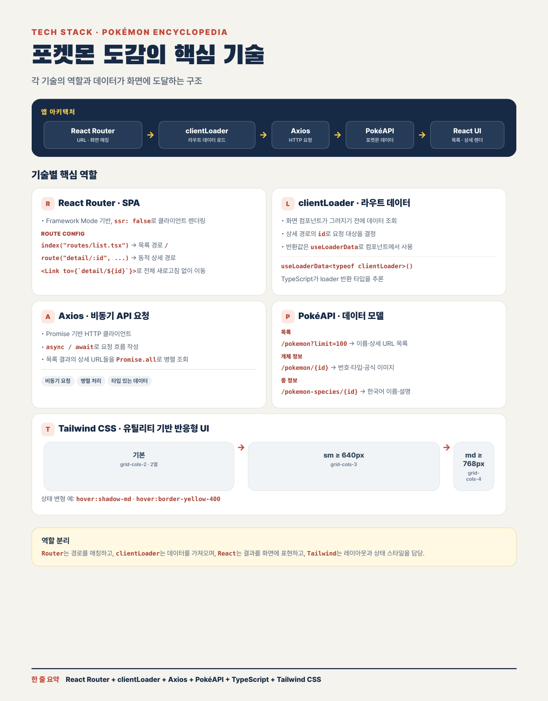
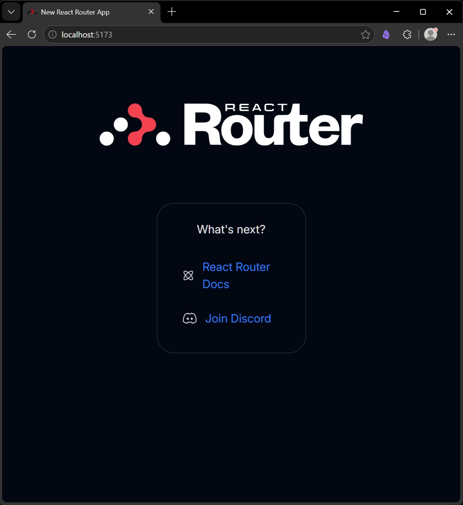
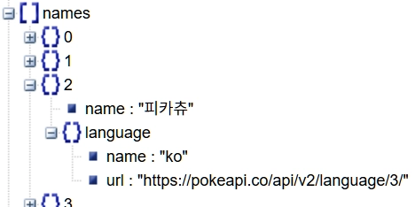

# Pokemon

# 💎목표

- React Router v7
    - Next.js, Tanstack Router 등의 메타 프레임워크 보다 쉽게 사용 가능
    - 이름만 라우터라고 생각하면 됨
    - 토스, 배달의민족 등에서 Remix (React Router v7) 사용
    - SSR(Server Side Rendering)은 사용하지 않고 CSR(Client Side Rendering)만 사용할 것임
    - 참고로 2026년 10월 현재 최신 버전은 v8 임
- Tailwind CSS
- Vercel 배포
- useEffect
- Axios
- clientLoader




# ⭐React Router

[React Router Official Documentation](https://reactrouter.com/)

- SPA(Single Page Application)에서 마치 여러 페이지가 있는 것처럼 client측에서 페이지를 라우팅해 줌
    - Routing (라우팅): 사용자가 요청한 path(경로)에 맞는 페이지(컴포넌트)를 보여주는 처리 과정
- URL이 변경되었을 때 어떤 component를 보여 줄 지 결정하는 라이브러리
- Web browser의 앞/뒤로가기 버튼 지원

## 💡React Router v7 탄생 비화

- "Remix가 어른의 사정으로 React Router v7을 만들었다.” 라고 이해하면 됨
- React Router 잘 만들어서 시작을 독점함
- “우리도 Next.js 처럼 Fullstack framework를 만들자”해서 Remix 개발
- Remix가 Next.js에 처참하게 밀림
- Shopify에서 Remix를 인수하면서 성과 압박을 받음
- 전 세계 개발자가 다운로드하는 react-router 브랜드와 통합하는 꼼수로 npm trends 점유율 그래프를 최상위권으로 뻥튀기함
    - react-router v6에 데이터 로더(loader)를 이식하면서 두 소스 코드가 95% 이상 똑같아지자, 회사 내부 비용 절감을 위해 하나로 합쳐버림
- 강의에서는 서버 기능(SSR) 말고 쉬운 CSR(SPA) 문법만 사용할 것임

## 💡3가지 모드 중에서 선택 가능

### 🔷Declarative Mode (선언적 모드)

- 가장 기본적인 라우팅 단계
- 기존의 React Router (v6)와 거의 똑같음

### 🔷Data Mode (데이터 모드)

- 1단계인 Declarative Mode의 모든 기능을 그대로 다 포함하면서, 데이터 처리 기능 추가

### 🔷✅Framework Mode (프레임워크 모드) (사용)

- 2단계인 Data Mode의 기능까지 전부 제공
- Vite 빌드 도구와 결합해 풀스택 프레임워크 수준의 강력한 기능 제공
- + 타입 안전성(Type-safe), 자동 코드 분할(Code splitting), 서버 사이드 렌더링(SSR), 파일 기반 라우팅 등

<aside>
🍰

정보

강의에서는 Framework mode 사용

</aside>

# ⭐React Router Project 생성

- pnpm 사용
    - [‣](https://app.notion.com/p/3e6daf211d428097a5b5dadd6c90a03e?pvs=21)

## 💡Vite를 사용한 React 생성

- cmd 또는 PowerShell 열어서 실행
    - VS Code의 Terminal 사용해도 됨

```bash
cd [본인의 작업 폴더]/Web2026
pnpm create vite w26w06-pokemon
```

<aside>
🍰

정보

이렇게 만들 수도 있음

pnpm dlx는 npx라고 생각하면 됨. 다운로드 받고 실행

```kotlin
pnpm dlx create-react-router@latest w26w05-pokemon
```

</aside>

- 아래 화살표로 이동하여 React 선택 후 Enter


- React Router v7 선택
    - ⚠️JavaScript 선택하지 않도록 주의


- git 초기화 Yes 선택되어 있으니 Enter


- 프로젝트 생성되고, 필요한 dependent modules 설치 Yes 선택되어 있으니 Enter
    - 2026년 10월초 현재 어차피 안되니 No 선택해도 됨
    - 수동으로 처리하면 되니 걱정할 것 없음


- AI 에이전트와 협업할 때 도움이 되는 AI 연동 기능
- 나중에 현업에서 실제 개발할 때는 Yes 선택할 것
- 현재는 복잡한 코드가 추가되면 오히려 불편하니 No 선택


- 실패했음. 어라????

<aside>
🍰

정보

Install dependencies with pnpm? 에서 No 선택했을 때 성공 화면


</aside>

- CMD 또는 PowerShell 창 닫을 것

# ⭐VSCode로 폴더 열기

## 💡Open Folder…

- Manage


- Trust


- 닫을 것


## 💡실행 확인

- 터미널 Ctrl+ `
- Dependecies 설치

```bash
pnpm i
```


- 서버 실행

```bash
pnpm dev
```


- 웹 브라우저 열어서 확인

```tsx
http://localhost:5173/
```

- 정상 확인



# ⭐React Router

## 💡**routes.ts 설정 파일 (React Router v8 방식)**

- **v8에서는 app/routes.ts 설정 파일을 사용**
    - 주소록을 따로 관리하는 것처럼 routes.ts 파일 하나에 모두 기술함
    - 서버 사이드 렌더링(SSR), 자동 최적화, 자동 타입 생성(+types)을 위한 필수적인 방식임
- 대표적으로 index()와 route() 함수를 사용해 경로를 지정
    - **index()**: 기본 홈 경로( / ) 정의할 때 사용
    - **route()**: 특정 URL path에 대해 어떤 파일(컴포넌트)을 매칭할지 정의
    - 동적 파라미터 예제: route("pokemon/:id", "routes/pokemon-detail.tsx")

## 💡Link (React Router 컴포넌트)

- HTML의 a tag라고 생각하면 편함
    - a tag는 화면을 새로고침(껌뻑~)하여 전환
    - Link는 새로고침 없이 컴포넌트만 갈아 끼움 (깜빡임 없음)
- 어떤 URL path로 이동할지 to attribute에 지정

## 💡app/routes.ts

- 포켓몬 리스트를 보여주는 경로와 세부 정보를 보여주는 경로  두 개 필요
- list.tsx 및 detail.tsx 파일 생성 필요함
- 일단은 list만 처리
- index를 사용하면 앱이 처음 실행될 때 list가 뜨게됨

```tsx
import { type RouteConfig, index } from "@react-router/dev/routes";

export default [
  index("routes/list.tsx")
] satisfies RouteConfig;
```

## 💡welcome/welcome.tsx는 삭제

- welcome 디렉토리 자체 삭제
- welcome 디렉토리 선택


- Del 키 눌러서 삭제


- 또는, Shift+Del 완전히 삭제


## 💡home.tsx 파일 선택

- F2 눌러서 list로 파일명 변경


- Enter


## 💡app/routes/list.tsx

<aside>
🍰

정보

React Router v7부터는 파일명을 대문자로 시작하는 PascalCase 쓰지 않음

대신, 모두 소문자로 쓰고 마이너스로 연결하는 kebab-case 사용

</aside>

- meta 부분 변경

```tsx
import type { Route } from "./+types/list";
//import { Welcome } from "../welcome/welcome";

export function meta({}: Route.MetaArgs) {
  return [
    { title: "포켓몬스터" },
    { name: "description", content: "포켓몬 도감" },
  ];
}

export default function List() {
  return <h2>포켓몬 목록</h2>;
}

```

## 💡실행 확인

- pnpm dev를 Ctrl+C 두 번 눌러서 종료한 후 다시 실행


- 다시 실행

```tsx
pnpm dev
```

- 웹 브라우저 확인


## 💡app/routes.ts

- 포켓몬 리스트를 보여주는 경로와 세부 정보를 보여주는 경로  두 개 필요
- route() 함수로 detail 추가
- 윗줄 index() 함수 끝에 콤마 추가 필요
- detail.tsx 파일 생성 필요함

```tsx
import { type RouteConfig, index, route } from "@react-router/dev/routes";

export default [
  index("routes/list.tsx"),    
  route("detail", "routes/detail.tsx"),
] satisfies RouteConfig;
```

## 💡app/routes/detail.tsx

- detail.tsx 파일 추가
- routes 눌러서 선택한 뒤에


- 문서에 + 있는 아이콘 (New File…) 눌러서 파일 생성


- detail.tsx 입력


- Detail 컴포넌트 생성

```jsx
import type { Route } from "./+types/detail";

export default function Detail() {
  return <h2>상세 정보</h2>;
}

```

## 💡실행 확인

- 웹 브라우저 주소창에 입력

```tsx
http://localhost:5173/detail
```


## 🎁GitHub

```tsx
🎉routes 생성
```

---

# ⭐포켓몬 더미 데이터 사용

<aside>
🍰

정보

좋은 구조를 위해서는 분리하는 것이 좋음

관심사 분리(Separation of Concerns, SoC)라고 말함

"하나의 코드(컴포넌트, 함수, 파일)는 단 한 가지 종류의 일(관심사)만 책임지게 하자"라는 프로그래밍 원칙

다음의 TypeScript 처럼 interface 사용하는 것이 좋음. (JS에는 interface 없음)

```kotlin
export interface IPokemonRepository {
  getPokemonList(): Promise<Pokemon[]>
  getPokemonDetail(id: number): Promise<Pokemon>
}
```

더미 데이터 repository (TypeScript)

```kotlin
export class MockPokemonRepository implements IPokemonRepository {
  async getPokemonList(): Promise<Pokemon[]> {
    return pokemons;
  }

  async getPokemonDetail(id: number): Promise<Pokemon> {
    const found = pokemons.find(p => p.id === id);
    
    if (!found) {
      throw new Error(`ID가 ${id}인 포켓몬을 찾을 수 없습니다.`);
    }
    
    return found;
  }
}
```

</aside>

## 💡 app/routes/list.tsx

- 더미 데이터
- map() 함수로 배열의 각 포켓몬 출력

```tsx
import type { Route } from "./+types/list";

 const pokemons = [
    { id: 1, name: "이상해씨", image: "https://raw.githubusercontent.com/PokeAPI/sprites/master/sprites/pokemon/other/official-artwork/1.png" },
    { id: 4, name: "파이리", image: "https://raw.githubusercontent.com/PokeAPI/sprites/master/sprites/pokemon/other/official-artwork/4.png" },
    { id: 7, name: "꼬부기", image: "https://raw.githubusercontent.com/PokeAPI/sprites/master/sprites/pokemon/other/official-artwork/7.png" },
    { id: 25, name: "피카츄", image: "https://raw.githubusercontent.com/PokeAPI/sprites/master/sprites/pokemon/other/official-artwork/25.png" },
    { id: 39, name: "니드런♀", image: "https://raw.githubusercontent.com/PokeAPI/sprites/master/sprites/pokemon/other/official-artwork/29.png" },
    { id: 52, name: "니드런♂", image: "https://raw.githubusercontent.com/PokeAPI/sprites/master/sprites/pokemon/other/official-artwork/32.png" },
    { id: 133, name: "이브이", image: "https://raw.githubusercontent.com/PokeAPI/sprites/master/sprites/pokemon/other/official-artwork/133.png" },
    { id: 150, name: "뮤츠", image: "https://raw.githubusercontent.com/PokeAPI/sprites/master/sprites/pokemon/other/official-artwork/150.png" },
    { id: 151, name: "뮤", image: "https://raw.githubusercontent.com/PokeAPI/sprites/master/sprites/pokemon/other/official-artwork/151.png" },
    { id: 152, name: "치코리타", image: "https://raw.githubusercontent.com/PokeAPI/sprites/master/sprites/pokemon/other/official-artwork/152.png" },
  ]

export function meta({}: Route.MetaArgs) {
  return [
    { title: "포켓몬" },
    { name: "description", content: "포켓몬 도감" },
  ];
}

export default function List() {
  return (
    <div>
      <h2>포켓몬 목록</h2>
      <div>
        {pokemons.map((pokemon) => (
          <div key={pokemon.id}>
            
            <p>{pokemon.name}</p>
          </div>
        ))}
      </div>
    </div>
  );
}

```

## 💡실행 확인


## 💡app/routes/detail.tsx

- 더미 데이터

```tsx
import type { Route } from "./+types/detail";

const pokemon = { id: 25, name: "피카츄", image: "https://raw.githubusercontent.com/PokeAPI/sprites/master/sprites/pokemon/other/official-artwork/25.png" }

export default function Detail() {
  const p = pokemon

  return (
    <div>
      <div>
        
        <h1>{p.name}</h1>
        <span>
          No. {p.id}
        </span>
      </div>
    </div>
  );
}

```

## 💡실행 확인

```tsx
http://localhost:5173/detail
```


## 🎁GitHub

```tsx
🤡더미 데이터
```

# ⭐AI 활용

## 💡 OpenCode

- [‣](https://app.notion.com/p/3efdaf211d4280bb884bd0bae41ce66d?pvs=21)

## 💡Kilo Code

- [‣](https://app.notion.com/p/3f0daf211d4280cbb7c1cf7369987f02?pvs=21)

## 💡Google AI Studio

- [‣](https://app.notion.com/p/3eedaf211d4280d4a948f6a4f379bbda?pvs=21)

<aside>
🧠

AI

```tsx
다음 코드에 Tailwind CSS를 적용하여 포켓몬이 카드 형태로 미려하게 나타나도록 만들어줘.

export default function List() {
  return (
    <div>
      <h2>포켓몬 목록</h2>
      <div>
        {pokemons.map((pokemon) => (
          <div key={pokemon.id}>
            
            <p>{pokemon.name}</p>
          </div>
        ))}
      </div>
    </div>
  );
}
```

- 결과
    
    ```tsx
    export default function List() {
      return (
        <div className="min-h-screen bg-gray-50 py-10 px-4 sm:px-6 lg:px-8">
          {/* 제목 영역 */}
          <h2 className="text-3xl font-extrabold text-center text-gray-900 mb-10 tracking-tight">
            ✨ 포켓몬 목록
          </h2>
          
          {/* 카드 그리드 컨테이너 */}
          <div className="max-w-7xl mx-auto grid grid-cols-2 sm:grid-cols-3 md:grid-cols-4 lg:grid-cols-5 gap-6">
            {pokemons.map((pokemon) => (
              <div 
                key={pokemon.id} 
                className="group relative bg-white border border-gray-100 rounded-2xl p-4 shadow-sm hover:shadow-xl hover:-translate-y-1.5 transition-all duration-300 ease-in-out flex flex-col items-center justify-between"
              >
                {/* 부드러운 배경이 들어간 이미지 영역 */}
                <div className="w-full aspect-square bg-gray-50 rounded-xl flex items-center justify-center p-2 mb-4 group-hover:bg-amber-50 transition-colors duration-300">
                  
                </div>
                
                {/* 포켓몬 정보 영역 */}
                <div className="w-full text-center">
                  <span className="text-xs font-semibold text-gray-400 tracking-wider">
                    #{String(pokemon.id).padStart(3, '0')}
                  </span>
                  <p className="text-lg font-bold text-gray-800 mt-1 group-hover:text-amber-600 transition-colors duration-200">
                    {pokemon.name}
                  </p>
                </div>
              </div>
            ))}
          </div>
        </div>
      );
    }
    ```
    


</aside>

# ⭐ Tailwind CSS 레이아웃 구성

[Tailwind CSS - Rapidly build modern websites without ever leaving your HTML.](https://tailwindcss.com/)

- 전체적인 도감의 외형과 뼈대 레이아웃 구성
- 클래스 기반의 디자인 시스템인 Tailwind CSS 적용
- 반응형 (적응형) 화면 구성

## 💡상태 변형 (Modifier:) = 사용자의 행동에 반응하기

- 특정 조건이나 사용자 액션이 일어났을 때 스타일을 바꾸는 규칙
- 사용자가 웹사이트와 상호작용하는 모든 순간을 제어합니다.
- hover:  마우스를 올렸을 때 (예: 버튼 색상 바꾸기)
- focus:  입력창(input)을 클릭해 커서가 깜빡일 때 (예: 테두리 빛나게 하기)
- active:  요소를 마우스로 꾹 누르고 있는 순간

## 💡반응형 브레이크포인트 (Breakpoint:) = 기기 화면 크기에 맞추기

- sm:, md:처럼 스마트폰, 태블릿, 모니터 등 화면 너비에 따라 레이아웃을 자동 조절
- 하나의 코드로 모바일과 PC 화면을 동시에 대응할 수 있음
- 기본 (접두사 없음): 모바일 화면 기준 (기본값)
- sm: — 태블릿 / 작은 화면 (640px 이상)
- md: — 일반 모니터 / 노트북 (768px 이상)
- lg: — 큰 모니터 (1024px 이상)

## 💡app/routes/list.tsx

- 포켓몬 카드형 목록
- className에 하나씩 적용해 보면서 무엇을 지정하면 어떻게 그려지는지 확인해 볼 것

```tsx
import type { Route } from "./+types/list"

 const pokemons = [
    { id: 1, name: "이상해씨", image: "https://raw.githubusercontent.com/PokeAPI/sprites/master/sprites/pokemon/other/official-artwork/1.png" },
    { id: 4, name: "파이리", image: "https://raw.githubusercontent.com/PokeAPI/sprites/master/sprites/pokemon/other/official-artwork/4.png" },
    { id: 7, name: "꼬부기", image: "https://raw.githubusercontent.com/PokeAPI/sprites/master/sprites/pokemon/other/official-artwork/7.png" },
    { id: 25, name: "피카츄", image: "https://raw.githubusercontent.com/PokeAPI/sprites/master/sprites/pokemon/other/official-artwork/25.png" },
    { id: 39, name: "니드런♀", image: "https://raw.githubusercontent.com/PokeAPI/sprites/master/sprites/pokemon/other/official-artwork/29.png" },
    { id: 52, name: "니드런♂", image: "https://raw.githubusercontent.com/PokeAPI/sprites/master/sprites/pokemon/other/official-artwork/32.png" },
    { id: 133, name: "이브이", image: "https://raw.githubusercontent.com/PokeAPI/sprites/master/sprites/pokemon/other/official-artwork/133.png" },
    { id: 150, name: "뮤츠", image: "https://raw.githubusercontent.com/PokeAPI/sprites/master/sprites/pokemon/other/official-artwork/150.png" },
    { id: 151, name: "뮤", image: "https://raw.githubusercontent.com/PokeAPI/sprites/master/sprites/pokemon/other/official-artwork/151.png" },
    { id: 152, name: "치코리타", image: "https://raw.githubusercontent.com/PokeAPI/sprites/master/sprites/pokemon/other/official-artwork/152.png" },
  ]

export function meta({}: Route.MetaArgs) {
  return [
    { title: "포켓몬" },
    { name: "description", content: "포켓몬 도감" },
  ]
}

export default function List() {
  return (
    <div className="min-h-screen bg-slate-50 p-6">
      <h1 className="text-2xl font-bold mb-6 text-slate-800">포켓몬 목록</h1>

      <div className="grid grid-cols-2 gap-4 sm:grid-cols-3 md:grid-cols-4">
        {pokemons.map((pokemon) => (
          <div className="bg-white rounded-xl shadow hover:shadow-md transition
                      p-4 flex flex-col items-center gap-2
                      border border-slate-200 hover:border-yellow-400"
            key={pokemon.id}>
            
            <p className="font-semibold text-slate-700">{pokemon.name}</p>
          </div>
        ))}
      </div>
    </div>
  )
}

```

## 💡Tailwind 클래스

| 클래스 | 역할 |
| --- | --- |
| min-h-screen | 화면 높이만큼 최소 확보 (배경이 빈 공간까지 차감) |
| bg-slate-50 | 페이지 전체 아주 연한 회색 배경 |
| p-6 | 페이지 안쪽 패딩 1.5rem |
| text-2xl | 제목 글자 크기 |
| font-bold | 제목 굵게 |
| mb-6 | 제목 아래 여백 |
| text-slate-800 | 제목 글자 색 (진한 회색) |
| grid | Grid 레이아웃 |
| grid-cols-2 | 2열 정렬 |
| gap-4 | 카드 사이 간격 1rem |
| sm:grid-cols-3 | 화면 sm 이상이면 3열 (반응형) |
| md:grid-cols-4 | 화면 md 이상이면 4열 (반응형) |
| bg-white | 배경 흰색 (카드 몸통) |
| rounded-xl | 모서리 둥글게 |
| shadow | 그림자 |
| hover:shadow-md | 마우스 올리면 그림자 강해짐 |
| transition | hover 변화가 부드럽게 (0.15s) |
| p-4 | 카드 안쪽 패딩 1rem |
| flex | Flex 레이아웃 |
| flex-col | 세로 정렬 |
| items-center | 가로 가운데 정렬 |
| gap-2 | 카드 안 요소 간격 0.5rem |
| border | 테두리 |
| border-slate-200 | 연한 회색 테두리 |
| hover:border-yellow-400 | hover 시 테두리 노란색으로 |
| w-24 h-24 | 이미지 4rem(64px) 정사각형 |
| font-semibold | 카드 이름 글자 반쯤 굵게 |
| text-slate-700 | 카드 이름 글자 색 |

## 💡실행 확인


## 💡app/routes/detail.tsx

- 더미 데이터 하드 코딩
- rounded-full → 완전 동그란 "배지(pill)" 만들기
- px-3 py-1 → 좌우/상하 따로 패딩

```tsx
import type { Route } from "./+types/detail";

const pokemon = { id: 25, name: "피카츄", image: "https://raw.githubusercontent.com/PokeAPI/sprites/master/sprites/pokemon/other/official-artwork/25.png" }

export default function Detail() {
  const p = pokemon

  return (
    <div className="min-h-screen bg-slate-50 p-6">
      <div className="bg-white rounded-xl shadow p-8 max-w-md mx-auto
                      text-center flex flex-col items-center gap-4">
        
        <h1 className="text-3xl font-bold text-slate-800">{p.name}</h1>
        <span className="text-xs bg-yellow-100 text-yellow-700 px-3 py-1 rounded-full">
          No. {p.id}
        </span>
      </div>
    </div>
  );
}

```

## 💡실행 확인

```bash
http://localhost:5173/detail
```


## 🎁GitHub

```tsx
💄Tailwind CSS 적용
```

# ⭐Link

- List에서 포켓몬 누르면 Detail 출력

## 💡routes/routes.ts

- detail에 /:id 추가

```kotlin
export default [
  index("routes/list.tsx"),
  route("detail/:id", "routes/detail.tsx"),
] satisfies RouteConfig
```

## 💡routes/list.tsx

- div 대신 Link 사용

```kotlin
import { Link } from "react-router"
```

<aside>
⚠️

주의

따옴표가 아니라 backtick ` 사용

</aside>

```kotlin
export default function List() {
  return (
    <div className="min-h-screen bg-slate-50 p-6">
      <h1 className="text-2xl font-bold mb-6 text-slate-800">포켓몬 목록</h1>

      <div className="grid grid-cols-2 gap-4 sm:grid-cols-3 md:grid-cols-4">
        {pokemons.map((pokemon) => (
          <Link 
            to={`detail/${pokemon.id}`}
            className="bg-white rounded-xl shadow hover:shadow-md transition
                      p-4 flex flex-col items-center gap-2
                      border border-slate-200 hover:border-yellow-400"
            key={pokemon.id}>
            
            <p className="font-semibold text-slate-700">{pokemon.name}</p>
          </Link>
        ))}
      </div>
    </div>
  )
}
```

## 💡routes/detail.tsx

- "./+types/detail": '타입 안전성(Type Safety)'을 위한 자동 생성 파일 시스템
- params. 까지 쓰면 id가 있다고 알려줌


<aside>
⚠️

주의

이렇게 하드 코딩하고, List와 Detail에 같은 코드를 복사 붙여넣기  하면 안됨!

강의 진행하기 위해서만 임시로 사용

</aside>

```kotlin
import { Link } from "react-router"
import type { Route } from "./+types/detail"

// NOTE: 이렇게 하드 코딩하고, 복사 붙여넣기 하면 안됨!
const pokemons = [
  { id: 1, name: "이상해씨", image: "https://raw.githubusercontent.com/PokeAPI/sprites/master/sprites/pokemon/other/official-artwork/1.png" },
  { id: 4, name: "파이리", image: "https://raw.githubusercontent.com/PokeAPI/sprites/master/sprites/pokemon/other/official-artwork/4.png" },
  { id: 7, name: "꼬부기", image: "https://raw.githubusercontent.com/PokeAPI/sprites/master/sprites/pokemon/other/official-artwork/7.png" },
  { id: 25, name: "피카츄", image: "https://raw.githubusercontent.com/PokeAPI/sprites/master/sprites/pokemon/other/official-artwork/25.png" },
  { id: 39, name: "니드런♀", image: "https://raw.githubusercontent.com/PokeAPI/sprites/master/sprites/pokemon/other/official-artwork/29.png" },
  { id: 52, name: "니드런♂", image: "https://raw.githubusercontent.com/PokeAPI/sprites/master/sprites/pokemon/other/official-artwork/32.png" },
  { id: 133, name: "이브이", image: "https://raw.githubusercontent.com/PokeAPI/sprites/master/sprites/pokemon/other/official-artwork/133.png" },
  { id: 150, name: "뮤츠", image: "https://raw.githubusercontent.com/PokeAPI/sprites/master/sprites/pokemon/other/official-artwork/150.png" },
  { id: 151, name: "뮤", image: "https://raw.githubusercontent.com/PokeAPI/sprites/master/sprites/pokemon/other/official-artwork/151.png" },
  { id: 152, name: "치코리타", image: "https://raw.githubusercontent.com/PokeAPI/sprites/master/sprites/pokemon/other/official-artwork/152.png" },
]

export default function Detail({ params }: Route.ComponentProps) {
  const pokemon = pokemons.find(p => p.id === Number(params.id))
  if (!pokemon) {
    return <div className="min-h-screen bg-slate-700 p-6">포켓몬을 찾을 수 없습니다.</div>
  }
  
  return (
    <div className="min-h-screen bg-slate-50 p-6">
      <Link 
        to="/" 
        className="mb-3 block mx-auto w-max px-6 py-2 bg-slate-400 hover:bg-slate-700 text-white text-sm rounded-lg">
        목록으로 돌아가기
      </Link>
      <div className="bg-white rounded-xl shadow p-8 max-w-md mx-auto
                      text-center flex flex-col items-center gap-4">
        
        <h1 className="text-3xl font-bold text-slate-800">{pokemon.name}</h1>
        <span className="text-xs bg-yellow-100 text-yellow-700 px-3 py-1 rounded-full">
          No. {pokemon.id}
        </span>
      </div>
    </div>
  )
}

```


## 🎁GitHub

```kotlin
✨Detail Link
```

# ⭐Asynchronous

## 💡Asynchronous (비동기) 처리

- 시간이 오래 걸리는 작업 처리할 때 권장함
- 다 끝난 뒤에 뭘 할지 callback 함수 전달
- 요청한 뒤에 기다리지 않고 다음 작업 처리
- 요청한 작업이 끝나면 callback 함수 실행

<aside>
🍰

개념

“부장님, 이거 어떻게 처리할까요?”

카카오톡을 보낸 뒤에 답이 올 때까지 아무 것도 안하고 기다리지 않음

물어 본 뒤에 다른 작업 처리하다가 답이 오면 그 일 처리하는 것이 Async. (비동기)

</aside>

- 그럼 Asynchronous가 좋은건가?

## 💡Callback 지옥

- Callback A 함수 안에서 다음 작업 요청하면서 다 끝난 뒤에 수행할 callback 함수 B 전달
- Callback B 함수 안에서 다음 작업 요청하면서 다 끝난 뒤에 수행할 callback 함수 C 전달
- …
- 중첩된 콜백 함수들로 인해 코드가 복잡해지고, 디버깅 및 유지 보수가 어려워 지는 상황 발생

```jsx
function getData(url, callback) {
  http.get(url, (res) => {
    let data = ""

    res.on("data", (chunk) => {
      data += chunk
    })

    res.on("end", () => {
      callback(null, data)
    })

  }).on("error", (err) => {
    callback(err)
  })
}

// 콜백 지옥: 순차적으로 API 요청
getData("http://api.example.com/data", (err, data1) => {
  if (err) return console.error(err)
  console.log("data1:", data1)

  getData("http://api.example.com/nextData", (err, data2) => {
    if (err) return console.error(err)
    console.log("data2:", data2)

    getData("http://api.example.com/finalData", (err, data3) => {
      if (err) return console.error(err)
      console.log("data3:", data3)

      // 계속 이렇게 중첩되면 유지보수가 매우 힘들어짐
    })
  })
})
```

## 💡 Promise 기반 Asynchronous (비동기) 처리

<aside>
🍰

정보

Promise는 "지금 당장은 아니지만, 미래의 어느 시점에 값을 돌려주겠다(then), 혹은 에러가 발생했다는 것을 알려주겠다(catch)" 고 하는 비동기 작업의 최종 결과에 대한 약속을 의미함

</aside>

- then과 catch의 chaining을 사용하면 콜백 지옥보다 조금 나아짐
- then을 중첩해서 사용하면 여전히 복잡함

```jsx
axios.get("https://api.example.com/data")
  .then((res1) => {
    console.log("data1:", res1.data)
    return axios.get("https://api.example.com/nextData")
  })
  .then((res2) => {
    console.log("data2:", res2.data)
    return axios.get("https://api.example.com/finalData")
  })
  .then((res3) => {
    console.log("data3:", res3.data)
  })
  .catch((err) => {
    console.error(err)
  })

```

## 💡Synchronous (동기) 방식인 것처럼 코드 작성

- axios는 원래 비동기 방식으로 처리됨
- 함수에 async를 붙여주고, 함수 내부에서 await 사용하여 비동기 코드를 마치 동기 방식처럼 작성할 수 있음
    - 코드가 위에서 아래로 한 줄 한 줄 순차적으로 실행되는 것처럼 보임
- 실제 동작은 여전히 비동기 방식으로 처리됨
- JavaScript는 request가 끝날 때까지 기다리지만, main thread(UI rendering, 버튼 이벤트 처리 등)가 멈추지 않도록 처리해 줌

```jsx
async function getAllData() {
  try {
    const res1 = await axios.get("https://api.example.com/data")
    console.log("data1:", res1.data)

    const res2 = await axios.get("https://api.example.com/nextData")
    console.log("data2:", res2.data)

    const res3 = await axios.get("https://api.example.com/finalData")
    console.log("data3:", res3.data)
  } catch (err) {
    console.error(err)
  }
}

getAllData()
```

## 💡참고: Guard Clause

### 🔷사용하지 않았을 때 (권장하지 않음)

- Nested (중첩) if 문으로 계속 indenting (들여쓰기) 되어 복잡하고 가독성이 떨어짐

```jsx
async function fetchData() {
  const response = await axios.get('https://api.example.com/data');
  if (response && response.status === 200) {
    console.log(response.data);
    
    const nextResponse = await axios.get('https://api.example.com/nextData');
    if (nextResponse && nextResponse.status === 200) {
      console.log(nextResponse.data);
      
      const finalResponse = await axios.get('https://api.example.com/finalData');
      if (finalResponse && finalResponse.status === 200) {
        console.log(finalResponse.data);
      } else {
        console.error('Error occurred with final data.');
      }
    } else {
      console.error('Error occurred with next data.');
    }
  } else {
    console.error('Error occurred with initial data.');
  }
}

fetchData();

```

### 🔷사용했을 때 (권장)

- 문제가 생기면 바로 바로 return

```jsx
async function fetchData() {
  const response = await axios.get('https://api.example.com/data');
  if (!response || response.status !== 200) {
    console.error('Error occurred with initial data.');
    return;
  }
  console.log(response.data);

  const nextResponse = await axios.get('https://api.example.com/nextData');
  if (!nextResponse || nextResponse.status !== 200) {
    console.error('Error occurred with next data.');
    return;
  }
  console.log(nextResponse.data);

  const finalResponse = await axios.get('https://api.example.com/finalData');
  if (!finalResponse || finalResponse.status !== 200) {
    console.error('Error occurred with final data.');
    return;
  }
  console.log(finalResponse.data);
}

fetchData();

```

# ⭐Axios

- 서버와 클라이언트 간에 데이터를 주고받는 HTTP 요청을 처리해 주는 라이브러리

[First steps | axios | Promise based HTTP client](https://axios.rest/pages/getting-started/first-steps.html)

## 💡Axios 설치

- 터미널 추가 Ctrl+Shift+ `

```bash
pnpm add axios
```


# ⭐useEffect

[useEffect – React](https://ko.react.dev/reference/react/useEffect)

## 💡useEffect Hook은 언제 사용하나

- State가 변경되어 rendering 될 때 수행할 작업이 있다면 useEffect 사용
- Side effect는 ‘부작용’임
    - 부정적인 의미만 가지고 있지는 않음
    - 부수적으로 발생하는 효과를 광범위하게 의미함
- State가 변경될 때 부수적으로 수행하는 작업을 useEffect 사용하여 정의
- 1. 어떤 State가 변경될 때, 2. 어떤 작업을 수행할지 정의
    - 1번을 배열로 지정하여 여러 state가 변경될 때 동일한 작업을 수행할 수도 있음
    - 1번을 지정하지 않으면, 화면이 처음 rendering될 때 useEffect에 정의된 작업이 수행됨

## 💡의존 배열 차이

- list.tsx는 useEffect(() => {...}, []) → 빈 배열이라 1회만 실행 (목록은 한 번에 고정)
- detail.tsx는 useEffect(() => {...}, [id]) → id가 바뀔 때마다 재실행
- 의존 배열에 무엇을 넣느냐가 "언제 다시 호출되는지"를 결정

# ⭐ pokeAPI 접속

## 💡Requests

[PokéAPI](https://pokeapi.co/)

## 💡Pokemon List

```kotlin
https://pokeapi.co/api/v2/pokemon?limit=30
```

- results에 배열로 넘어옴


## 💡Pokemon Detail

```kotlin
https://pokeapi.co/api/v2/pokemon/25
```

- id
- name
- image: sprites.official-artwork.front_default


## 💡Pokemon Species

```kotlin
https://pokeapi.co/api/v2/pokemon-species/25
```


## 💡routes/list.tsx에서 목록 fetch

- 더미 데이터를 지우고, Axios를 사용하여 pokeAPI의 pokemon 목록을 받아옴
- 먼저 list.tsx에서 목록을 받아오고, 그 다음 detail.tsx로 넘어감
- [https://pokeapi.co/api/v2/pokemon?limit=100](https://pokeapi.co/api/v2/pokemon?limit=12) → name과 url만 100개 받음
- limit과 offset 파라미터로 개수 조절 가능
    - 현재는 100개만 가지고 옴

<aside>
🍰

정보

limit=100은 100개를 받는 뜻. 필요하면 숫자만 바꾸면 되고,
offset 파라미터로 페이지네이션(101번째부터 100개 등)도 만들 수 있음.

</aside>

- 카드가 만들어지기 전엔 "로딩 중…"만 보여주는 로딩 상태 관리
- length가 0이면 오류 메시지 출력

```tsx
import { useEffect, useState } from "react"
import axios from "axios"
import { Link } from "react-router"
import type { Route } from "./+types/list"

export function meta({}: Route.MetaArgs) {
  return [
    { title: "포켓몬" },
    { name: "description", content: "포켓몬 도감" },
  ]
}

type Pokemon = {
  id: number
  name: string
  image: string
}

export default function List() {
  const [pokemons, setPokemons] = useState<Pokemon[]>([])

  useEffect(() => {
    async function fetchPokemons() {
      try {
        const response = await axios.get("https://pokeapi.co/api/v2/pokemon?limit=100")
        const results = response.data.results
        // console.log("포켓몬 results[]:", results)
        
        // results.map을 통해 생성된 100개의 비동기 통신(Promise)들을 하나로 묶어 동시에 실행
        const pokemonData: Pokemon[] = await Promise.all(
          results.map(async ( {url} : { url: string }) => {
            const pokemonResponse = await axios.get(url)
            const { id, name, sprites } = pokemonResponse.data
            return {
              id,
              name,
              image: sprites.other["official-artwork"].front_default,
            }
          })
        )

        setPokemons(pokemonData)
      } catch (error) {
        console.error("포켓몬 데이터 에러: ", error)
      }
    }

    fetchPokemons()
  }, [])

  if (loading) {
    return (
      <div className="min-h-screen bg-slate-50 p-6 flex items-center justify-center text-xl font-semibold text-slate-900 animate-pulse">
        로딩 중...
      </div>
    )
  }

  if (pokemons.length === 0) {
    return (
      <div className="min-h-screen bg-slate-50 p-6 flex items-center justify-center text-xl font-semibold text-slate-900">
        포켓몬 데이터를 불러오지 못했습니다.
      </div>
    )
  }
  
  return (
    <div className="min-h-screen bg-slate-50 p-6">
      <h1 className="text-2xl font-bold mb-6 text-slate-800">포켓몬 목록</h1>

      <div className="grid grid-cols-2 gap-4 sm:grid-cols-3 md:grid-cols-4">
        {pokemons.map((pokemon) => (
          <Link 
            to={`detail/${pokemon.id}`}
            className="bg-white rounded-xl shadow hover:shadow-md transition
                      p-4 flex flex-col items-center gap-2
                      border border-slate-200 hover:border-yellow-400"
            key={pokemon.id}>
            
            <p className="font-semibold text-slate-700">{pokemon.name}</p>
          </Link>
        ))}
      </div>
    </div>
  )
}

```


## 💡상세 페이지에 fetch 추가 (routes/detail.tsx)

```tsx
import { useEffect, useState } from "react"
import axios from "axios"
import { Link } from "react-router"
import type { Route } from "./+types/detail"

type Pokemon = {
  id: number
  name: string
  types: { name: string }[]
  image: string
}

export default function Detail({ params }: Route.ComponentProps) {
  const [pokemon, setPokemon] = useState<Pokemon | null>(null)
  const [loading, setLoading] = useState(true)

  useEffect(() => {
    async function fetchPokemon() {
      try {
        const response = await axios.get(`https://pokeapi.co/api/v2/pokemon/${params.id}`)
        const { id, name, sprites } = response.data

        setPokemon({
          id,
          name,
          types: response.data.types,
          image: sprites.other["official-artwork"].front_default,
        })
      } catch (error) {
        console.error("포켓몬 데이터 에러: ", error)
      } finally {
        setLoading(false)
      }
    }

    fetchPokemon()
  }, [params.id])

  if (loading) {
    return (
      <div className="min-h-screen bg-slate-50 p-6 flex items-center justify-center text-xl font-semibold text-slate-900 animate-pulse">
        로딩 중...
      </div>
    )
  }

  if (!pokemon) {
    return (
      <div className="min-h-screen bg-slate-50 p-6 flex items-center justify-center text-xl font-semibold text-slate-900">
        포켓몬을 찾을 수 없습니다.
      </div>
    )
  }
  
  return (
    <div className="min-h-screen bg-slate-50 p-6">
      <Link 
        to="/" 
        className="mb-3 block mx-auto w-max px-6 py-2 bg-slate-400 hover:bg-slate-700 text-white text-sm rounded-lg">
        목록으로 돌아가기
      </Link>
      <div className="bg-white rounded-xl shadow p-8 max-w-md mx-auto
                      text-center flex flex-col items-center gap-4">
        
        <h1 className="text-3xl font-bold text-slate-800">{pokemon.name}</h1>
        <span className="text-xs bg-yellow-100 text-yellow-700 px-3 py-1 rounded-full">
          No. {pokemon.id}
        </span>
      </div>
    </div>
  )
}

```


## 🎁GitHub

```tsx
🌐Axios
```

# ⭐ clientLoader 사용

- useEffect + axios를 clientLoader로 바꾸기
- React Router가 데이터를 미리 받아주므로, useState/useEffect 없이 코드 최소화

## 💡SPA 모드 전환 (react-router.config.ts)

- clientLoader는 브라우저(클라이언트)에서 직접 데이터를 가져옴
- 서버 렌더링을 끄면(clientLoader) 페이지를 새로고침해도 데이터가 정상 로드됨

```tsx
import type { Config } from "@react-router/dev/config";

export default {
  // Config options...
  // Server-side render by default, to enable SPA mode set this to `false`
  ssr: false,
} satisfies Config;

```

<aside>
🍰

정보

ssr: false는 SPA (Single Page Application) 모드

서버가 데이터를 대신 받아줄 필요가 없고, 
브라우저에서 직접 API를 호출하므로, 배포 시 서버 없이 정적 파일만으로 충분해짐

</aside>

## 💡useEffect + Axios vs clientLoader

|  | useEffect + Axios | clientLoader |
| --- | --- | --- |
| 코드량 | useState·useEffect 필요 | 함수 1개 + useLoaderData |
| 데이터 시점 | 렌더 후 불러오기 (로딩 상태 표시 필요) | 렌더 전 미리 받아옴 |
| 로딩 처리 | if (loading) 처리 필요 | React Router가 자동 처리 |
| 재호출 | useEffect 의존 배열 관리 | Route 이동 시 자동 처리 |

## 💡routes/detail.tsx

- clientLoader가 컴포넌트가 그려지기 전에 데이터를 받아옴
- const pokemonId = url.pathname.split("/").filter(Boolean).pop()
    1. split("/"): ["", "api", "v2", "pokemon", "25", ""] 모양으로 분할
    2. filter(Boolean): 배열 안의 쓸모없는 빈 문자열("")들을 전부 제거
    • 결과: ["api", "v2", "pokemon", "25"]
    3. pop(): 정돈된 배열의 가장 마지막 아이템인 id 꺼냄
    • 최종 결과: "25"
- useLoaderData<typeof clientLoader>() → 받은 데이터 타입 자동 추론

```tsx
// import { useEffect, useState } from "react"
import axios from "axios"
import { Link, useLoaderData } from "react-router"
import type { Route } from "./+types/detail"

type Pokemon = {
  id: number
  name: string
  types: { name: string }[]
  image: string
}

export async function clientLoader({ request }: Route.ClientLoaderArgs) {
  const url = new URL(request.url)
  // 맨 마지막 id만 가져옴
  const pokemonId = url.pathname.split("/").filter(Boolean).pop()
  const response = await axios.get(`https://pokeapi.co/api/v2/pokemon/${pokemonId}`)
  const { id, name, sprites } = response.data

  return {
    id,
    name,
    types: response.data.types,
    image: sprites.other["official-artwork"].front_default,
  }
}

export default function Detail() {
  const pokemon = useLoaderData<typeof clientLoader>()

  return (
    <div className="min-h-screen bg-slate-50 p-6">
      <Link 
        to="/" 
        className="mb-3 block mx-auto w-max px-6 py-2 bg-slate-400 hover:bg-slate-700 text-white text-sm rounded-lg">
        목록으로 돌아가기
      </Link>
      <div className="bg-white rounded-xl shadow p-8 max-w-md mx-auto
                      text-center flex flex-col items-center gap-4">
        
        <h1 className="text-3xl font-bold text-slate-800">{pokemon.name}</h1>
        <span className="text-xs bg-yellow-100 text-yellow-700 px-3 py-1 rounded-full">
          No. {pokemon.id}
        </span>
      </div>
    </div>
  )
}

```

## 💡routes/list.tsx

- 간결하게 작성 가능
- 로딩 중… 없는 이유는, 다 받아온 다음에 움직이기 때문
- 일단 이동하고 기다리는 방식에서, 받아온 다음에 이동하는 방식으로 변경된 것임

```kotlin
// import { useEffect, useState } from "react"
import axios from "axios"
import { Link, useLoaderData } from "react-router"
import type { Route } from "./+types/list"

export function meta({}: Route.MetaArgs) {
  return [
    { title: "포켓몬" },
    { name: "description", content: "포켓몬 도감" },
  ]
}

type Pokemon = {
  id: number
  name: string
  image: string
}

export async function clientLoader({ request }: Route.ClientLoaderArgs) {
  const response = await axios.get("https://pokeapi.co/api/v2/pokemon?limit=100")
  const results = response.data.results

  const pokemonData: Pokemon[] = await Promise.all(
    results.map(async ({ url }: { url: string }) => {
      const pokemonResponse = await axios.get(url)
      const { id, name, sprites } = pokemonResponse.data
      return {
        id,
        name,
        image: sprites.other["official-artwork"].front_default,
      }
    })
  )

  return pokemonData
}

export default function List() {
  const pokemons = useLoaderData<typeof clientLoader>()

  return (
    <div className="min-h-screen bg-slate-50 p-6">
      <h1 className="text-2xl font-bold mb-6 text-slate-800">포켓몬 목록</h1>

      <div className="grid grid-cols-2 gap-4 sm:grid-cols-3 md:grid-cols-4">
        {pokemons.map((pokemon) => (
          <Link 
            to={`detail/${pokemon.id}`}
            className="bg-white rounded-xl shadow hover:shadow-md transition
                      p-4 flex flex-col items-center gap-2
                      border border-slate-200 hover:border-yellow-400"
            key={pokemon.id}>
            
            <p className="font-semibold text-slate-700">{pokemon.name}</p>
          </Link>
        ))}
      </div>
    </div>
  )
}
```

## 🎁GitHub

```kotlin
👔clientLoader
```

# ⭐한국어 이름

## 💡routes/list.tsx

<aside>
🍰

정보

names에 있는 item들을 하나씩 find()로 검사

item의 타입은 language를 가지고 있고, 그 자식으로 string 타입의 name을 가지고 있음을 지정함

```kotlin
(item: { language: { name: string } })
```



</aside>

```kotlin
export async function clientLoader({ request }: Route.ClientLoaderArgs) {
  const response = await axios.get("https://pokeapi.co/api/v2/pokemon?limit=100")
  const results = response.data.results

  const pokemonData: Pokemon[] = await Promise.all(
    results.map(async ({ url }: { url: string }) => {
      const pokemonResponse = await axios.get(url)
      const { id, name, sprites } = pokemonResponse.data

      const species = await axios.get(`https://pokeapi.co/api/v2/pokemon-species/${id}`)
      
      const koreanName = species.data.names.find(
        (item: { language: { name: string } }) => 
          item.language.name === "ko"
      )?.name

      return {
        id,
        name: koreanName || name,
        image: sprites.other["official-artwork"].front_default,
      }
    })
  )

  return pokemonData
}
```


## 💡routes/detail.tsx

```kotlin
export async function clientLoader({ request }: Route.ClientLoaderArgs) {
  const url = new URL(request.url)
  // 맨 마지막 id만 가져옴
  const pokemonId = url.pathname.split("/").filter(Boolean).pop()
  const response = await axios.get(`https://pokeapi.co/api/v2/pokemon/${pokemonId}`)
  const { id, name, sprites } = response.data

  const species = await axios.get(`https://pokeapi.co/api/v2/pokemon-species/${id}`)

  const koreanName = species.data.names.find(
    (item: { language: { name: string } }) => 
      item.language.name === "ko"
  )?.name

  return {
    id,
    name: koreanName || name,
    types: response.data.types,
    image: sprites.other["official-artwork"].front_default,
  }
}
```

## 🎁GitHub

```kotlin
🏷️한국어 이름
```

# ⭐한국어 설명


## 💡routes/detail.tsx

```kotlin
import axios from "axios"
import { Link, useLoaderData } from "react-router"
import type { Route } from "./+types/detail"

type Pokemon = {
  id: number
  name: string
  types: { name: string }[]
  image: string
  description?: string
}

export async function clientLoader({ request }: Route.ClientLoaderArgs) {
  const url = new URL(request.url)
  // 맨 마지막 id만 가져옴
  const pokemonId = url.pathname.split("/").filter(Boolean).pop()
  const response = await axios.get(`https://pokeapi.co/api/v2/pokemon/${pokemonId}`)
  const { id, name, sprites } = response.data

  const species = await axios.get(`https://pokeapi.co/api/v2/pokemon-species/${id}`)

  const koreanName = species.data.names.find(
    (item: { language: { name: string } }) => 
      item.language.name === "ko"
  )?.name

  const description = species.data.flavor_text_entries.find(
    (entry: { language: { name: string } }) => 
      entry.language.name === "ko"
  )?.flavor_text

  return {
    id,
    name: koreanName || name,
    types: response.data.types,
    image: sprites.other["official-artwork"].front_default,
    description
  }
}

export default function Detail() {
  const pokemon = useLoaderData<typeof clientLoader>()

  return (
    <div className="min-h-screen bg-slate-50 p-6">
      <Link 
        to="/" 
        className="mb-3 block mx-auto w-max px-6 py-2 bg-slate-400 hover:bg-slate-700 text-white text-sm rounded-lg">
        목록으로 돌아가기
      </Link>
      <div className="bg-white rounded-xl shadow p-8 max-w-md mx-auto
                      text-center flex flex-col items-center gap-4">
        
        <h1 className="text-3xl font-bold text-slate-800">{pokemon.name}</h1>
        <span className="text-xs bg-yellow-100 text-yellow-700 px-3 py-1 rounded-full">
          No. {pokemon.id}
        </span>
        {pokemon.description && (
          <p className="mt-4 text-center text-slate-600 max-w-md mx-auto">
            {pokemon.description}
          </p>
        )}
      </div>
    </div>
  )
}
```


## 🎁GitHub

```kotlin
🔍️한국어 설명
```

# ⭐Favicon 변경

## 💡피카추 이미지

```kotlin
https://raw.githubusercontent.com/PokeAPI/sprites/master/sprites/pokemon/other/home/25.png
```

- 파일명을 pikachu.png로 변경한 뒤에 public 폴더에 복붙
- Ctrl 누르고 Drag & Drop


## 💡app/root.tsx

```kotlin
export const links: Route.LinksFunction = () => [
  { rel: "preconnect", href: "https://fonts.googleapis.com" },
  {
    rel: "preconnect",
    href: "https://fonts.gstatic.com",
    crossOrigin: "anonymous",
  },
  {
    rel: "stylesheet",
    href: "https://fonts.googleapis.com/css2?family=Inter:ital,opsz,wght@0,14..32,100..900;1,14..32,100..900&display=swap",
  },
  { rel: "icon", href: "/pikachu.png", type: "image/png" },
];
```


## 🎁GitHub

```html
🍱favicon 추가
```

# 🚀Vercel을 통해 배포

## 💡SPA 라우팅을 위한 vercel.json 파일 생성

- 위치에 주의할 것


- vite.config.ts 있는 위치


- 정적 배포에서 /detail?id=25 같은 경로를 새로고침해도 404 안 나게 하기 위해
- 모든 요청을 index.html로 넘겨 클라이언트가 라우팅 처리하게 함

```json
{
  "rewrites": [
    {
      "source": "/(.*)",
      "destination": "/index.html"
    }
  ]
}
```

## 🎁GitHub

```kotlin
🚀Vercel
```

## 💡Vercel 가입

- Sign Up


- GitHub 계정으로 가입


- Authorize


- the account recovery form  작성하여 제출한 상태임


<aside>
🍰

정보

안되면 Netlify 사용하면 쉬움

</aside>